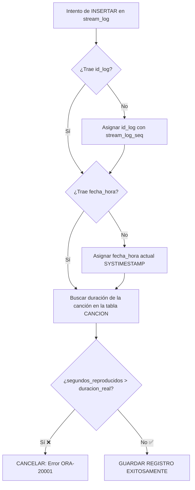

# 🛠️ Explicación del Trigger `TRG_STREAM_LOG_BI`

Este documento explica de forma sencilla qué es, qué hace y cómo funciona el disparador (*trigger*) y la secuencia (*sequence*) creados para la tabla `stream_log` en nuestra base de datos de streaming musical.

---

## 🎯 ¿Qué problema resolvemos?

Cuando un usuario escucha una canción en la plataforma, la aplicación envía un registro a la base de datos (`stream_log`). Sin embargo:
1. No queremos obligar a la aplicación a calcular el ID de cada log manualmente.
2. Si la aplicación no envía la fecha y hora exacta, queremos que el sistema la guarde automáticamente.
3. **Evitar datos imposibles:** Un usuario **no puede haber escuchado 500 segundos** de una canción que solo dura **212 segundos**.

---

## 🧩 Componentes Creados

### 1. La Secuencia (`stream_log_seq`)
Una secuencia es como un "turnero" numérico en un banco.
```sql
CREATE SEQUENCE stream_log_seq START WITH 100 INCREMENT BY 1;
```
* **¿Qué hace?**: Empieza en el número **100** y cada vez que le pedimos un número, nos da el siguiente (+1). Sirve para asignar los identificadores únicos (`id_log`) automáticamente.

---

### 2. El Trigger (`trg_stream_log_bi`)
Un *trigger* (o disparador) es un bloque de código que se ejecuta **automáticamente** cuando ocurre un evento en la base de datos. En este caso, se dispara **ANTES DE INSERTAR** (`BEFORE INSERT`) una fila en la tabla `stream_log`.

#### Pasos que realiza el Trigger en orden:



---

## 🔍 Explicación línea por línea del Código

```sql
CREATE OR REPLACE TRIGGER trg_stream_log_bi
BEFORE INSERT ON stream_log
FOR EACH ROW
```
> **En español**: "Crea un disparador llamado `trg_stream_log_bi`. Ejecútalo **ANTES DE INSERTAR** una nueva fila en la tabla `stream_log`, y evalúalo **para cada fila** (`FOR EACH ROW`) que se intente guardar."

---

```sql
DECLARE
  v_duracion cancion.duracion_segundos%TYPE;
```
> **En español**: Creamos una variable temporal llamada `v_duracion`. Su tipo de dato será exactamente igual al de la columna `duracion_segundos` de la tabla `cancion`.

---

```sql
BEGIN
  -- Autogenerar el ID si viene vacío
  IF :NEW.id_log IS NULL THEN
    :NEW.id_log := stream_log_seq.NEXTVAL;
  END IF;
```
> **En español**: Si el dato nuevo (`:NEW`) no trae un `id_log` (es nulo), pides el siguiente número a la secuencia y se lo asignas.

---

```sql
  -- Autocompletar la fecha si viene vacía
  IF :NEW.fecha_hora IS NULL THEN
    :NEW.fecha_hora := SYSTIMESTAMP;
  END IF;
```
> **En español**: Si no envían la fecha/hora de reproducción, le asignas la fecha y hora exacta del servidor en ese mismo instante (`SYSTIMESTAMP`).

---

```sql
  -- Validar contra la duración de la canción
  SELECT duracion_segundos
   INTO v_duracion
   FROM cancion
   WHERE id_cancion = :NEW.id_cancion;
```
> **En español**: Vamos a la tabla `cancion`, buscamos la canción que el usuario está escuchando (`:NEW.id_cancion`) y guardamos su duración total dentro de nuestra variable `v_duracion`.

---

```sql
  IF :NEW.segundos_reproducidos > v_duracion THEN
    RAISE_APPLICATION_ERROR(-20001,
      'Los segundos reproducidos (' || :NEW.segundos_reproducidos ||
      ') superan la duración de la canción (' || v_duracion || ').');
  END IF;
END;
/
```
> **En español**: Si los segundos que el usuario supuestamente escuchó (`:NEW.segundos_reproducidos`) son **mayores** a la duración real de la canción (`v_duracion`), cancelas todo y lanzas un mensaje de error personalizado (código de error `-20001`).

---

## 🧪 Ejemplos de Pruebas

### 1. Caso Exitoso ✅
```sql
INSERT INTO stream_log (id_usuario, id_cancion, segundos_reproducidos, id_pais)
VALUES (2, 20, 100, 2);
```
* La canción `20` dura **212 segundos**.
* Enviamos `100` segundos (100 <= 212).
* **Resultado**: Se inserta con éxito. Se le asigna un `id_log` automático (ej. 100) y la fecha/hora actual.

---

### 2. Caso con Error (Falla la validación) ❌
```sql
INSERT INTO stream_log (id_usuario, id_cancion, segundos_reproducidos, id_pais)
VALUES (2, 20, 500, 2);
```
* La canción `20` dura **212 segundos**.
* Intentamos enviar `500` segundos (500 > 212).
* **Resultado**: El trigger bloquea la inserción y muestra el mensaje:
  > `ORA-20001: Los segundos reproducidos (500) superan la duración de la canción (212).`